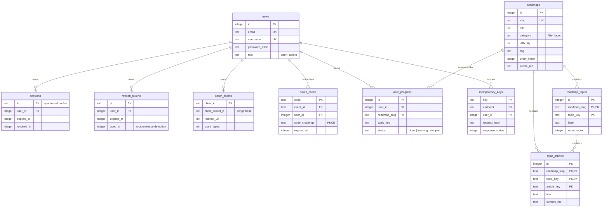

# Database Design

Relational schema for the API (SQLite via the built-in `node:sqlite` driver).
Schema lives in [`backend/src/db/migrations/001_init.sql`](../backend/src/db/migrations/001_init.sql).

## 1. Entity-Relationship diagram



## 2. Keys

- **Primary keys**: surrogate `INTEGER AUTOINCREMENT` for entities (`users`, `roadmaps`,
  `user_progress`); natural/opaque keys where an external identifier already exists
  (`sessions.id`, `refresh_tokens.jti`, `oauth_clients.client_id`, `oauth_codes.code`).
- **Foreign keys**: declared with `REFERENCES ... ON DELETE CASCADE` so deleting a user or a
  roadmap removes dependent rows (sessions, topics, articles, progress).
  `PRAGMA foreign_keys = ON` is set on every connection - SQLite enforces them.
- **Natural uniqueness**: `users.email`, `users.username`, `roadmaps.slug`,
  `(roadmap_slug, topic_key)`, `(roadmap_slug, topic_key, article_key)`.

## 3. Normalization (1NF -> 3NF)

- **1NF - atomic values**: every column holds one value; a roadmap's facets live in separate
  `category`, `difficulty`, `tag` columns (no `category,tag` comma lists).
- **2NF - no partial dependencies**: `topic_articles` uses the composite key
  `(roadmap_slug, topic_key, article_key)`; `title`/`content_md` depend on the **whole** key,
  not on a part of it. Everything else hangs off a single-column PK.
- **3NF - no transitive dependencies**: `roadmaps` does not store category *descriptions* or
  user data - only attributes of the roadmap itself. `user_progress` stores the reference
  (`roadmap_slug`) instead of duplicating the roadmap title; the API joins when a title is
  needed (`GET /me/progress`).

Denormalization deliberately **not** done: article counts are computed with correlated
subqueries instead of a cached `article_count` column - the write path stays simple.

## 4. Indexing and query performance

```sql
CREATE INDEX idx_roadmaps_category   ON roadmaps(category);
CREATE INDEX idx_roadmaps_tag        ON roadmaps(tag);
CREATE INDEX idx_roadmaps_difficulty ON roadmaps(difficulty);
CREATE INDEX idx_roadmaps_order      ON roadmaps(order_index);
CREATE INDEX idx_topics_roadmap      ON roadmap_topics(roadmap_slug, order_index);
CREATE INDEX idx_articles_topic      ON topic_articles(roadmap_slug, topic_key, order_index);
CREATE UNIQUE INDEX idx_progress_unique ON user_progress(user_id, roadmap_slug, topic_key);
CREATE INDEX idx_sessions_user       ON sessions(user_id);
CREATE INDEX idx_refresh_user        ON refresh_tokens(user_id);
```

- filters/sorts use indexed columns; the list query orders by `order_index` (indexed) with
  `slug` as a deterministic tie-breaker.
- `idx_progress_unique` doubles as the lookup index for the upsert
  (`ON CONFLICT(user_id, roadmap_slug, topic_key)`).
- Check plans with `.explain` / `EXPLAIN QUERY PLAN SELECT ...` in `sqlite3`.

## 5. SQL vs NoSQL - why this choice

| Requirement here | Better fit |
|---|---|
| relational data (users -> sessions, roadmaps -> topics -> articles) with referential integrity | **SQL** (FKs, cascades) |
| structured filters + sorting + pagination + aggregations (progress %) | **SQL** |
| predictable, moderate read volume; single-node deployment | **SQLite** (zero-ops, file-based) |
| huge write throughput / geo distribution / flexible nested documents | MongoDB/Cassandra |
| sub-millisecond shared cache, rate-limit counters, leader election | Redis (key-value) |

Mapping to the classic NoSQL models (implemented or not):
- **Document store (MongoDB)** would model a roadmap as one document with embedded
  `topics[]`/`articles[]` - great until articles are updated independently.
- **Key-value (Redis/DynamoDB)** is exactly what `src/lib/cache.js` emulates in-process
  (key -> JSON value + TTL) and what the rate limiter uses for counters.
- **Wide-column (Cassandra)** fits time-series/event data with per-partition clustering -
  not needed for transactional CRUD.

Consistency: reads after writes must be immediately correct (progress %), so a single
primary SQL database with synchronous commits is the honest choice; eventual consistency
(read replicas) is a scale trade-off described in [SCALING_CACHING.md](./SCALING_CACHING.md).

## 6. Schema migrations

A dependency-free runner ([`backend/src/db/migrate.js`](../backend/src/db/migrate.js)):

1. ensures the `schema_migrations(name, applied_at)` bookkeeping table exists
2. applies every `migrations/*.sql` file **once**, in filename order, each inside a transaction
3. records the file name - an already-applied migration is never re-run

Adding a change:

```bash
# 1. create the next file
vim backend/src/db/migrations/002_add_bookmarks.sql
# 2. apply it (server also auto-migrates on boot)
npm run migrate
```

Conventions: additive-only in production (new tables/columns first, backfill, then switch);
`DROP`/narrowing changes ship as a follow-up migration after old writers are gone.
